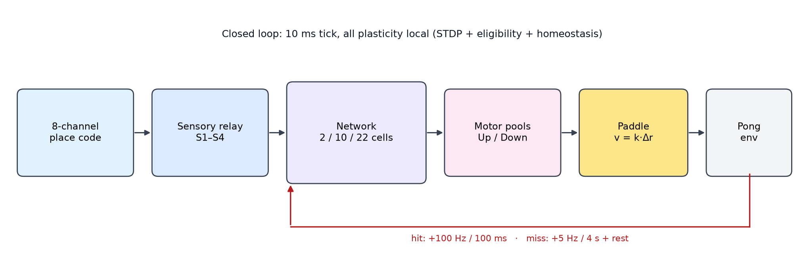
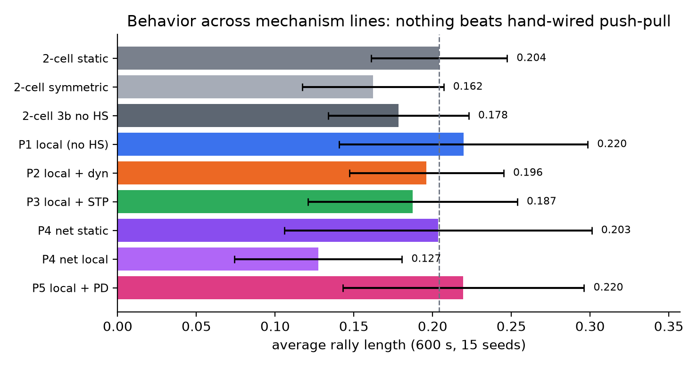
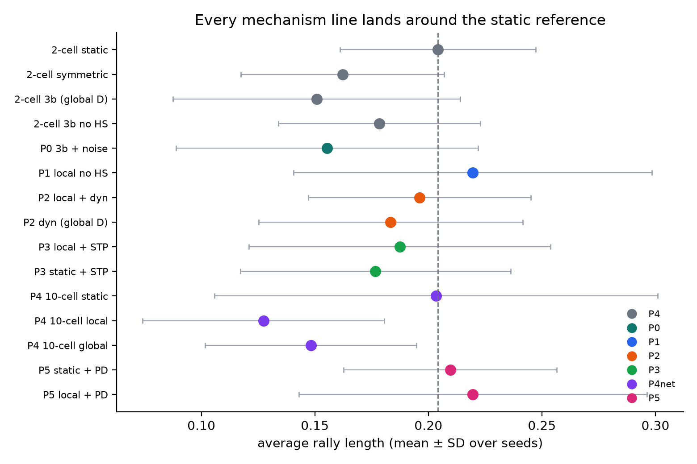
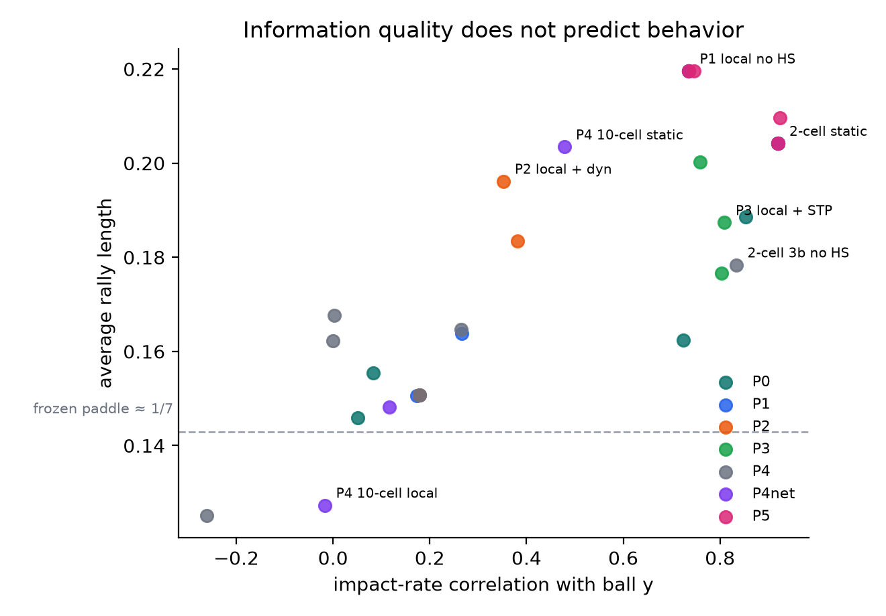
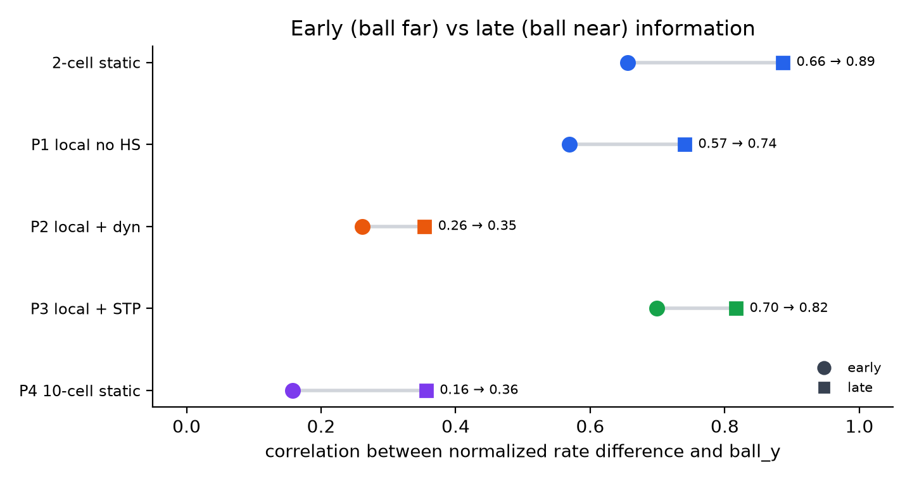
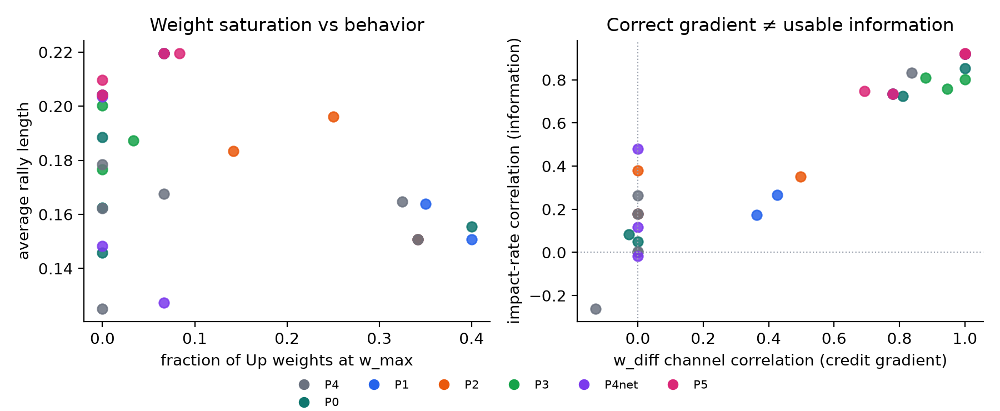
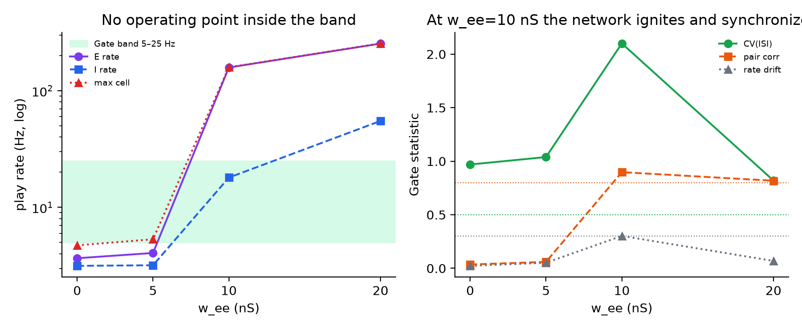

# BBN 最终报告：极小网络的 DishBrain 式闭环学习

- 版本：v0.22.0-phase7-recurrent-ei
- 日期：2026-10-23
- 范围：Phase 0–5（P0–P5）、Phase 6a 与 Phase 7a，2–22 细胞
- 预注册与逐阶段报告：`HANDOFF.md`、`results/phase*_report.md`、`docs/parameter_policy.md`
- 数据与图：`results/`、`results/figures/`；图由 `experiments/final_summary_figures.py` 从结果 CSV 生成

---

## 0. 摘要

1. **结构 > 可塑性。** 手工 push-pull 差分读出（2 细胞 static）在 600 s 内稳定优于 symmetric 与 random paddle，而之后八条机制线没有任何一条在行为上超过它。
2. **局部规则能在信号层成功。** 池特异信用把 `w_diff` 与通道的梯度从 0.000 提到 **0.780**；STP 把 early 信息相关从 0.569 提到 **0.699**、把冲击前读出相关从 0.735 提到 **0.809**。但这些都没有转化为行为增益。
3. **行为瓶颈不在“信息量”。** 冲击前读出相关横跨 0.0–0.92，行为却集中在 0.13–0.22；信息质量与行为几乎不相关。
4. **真正的瓶颈是信息到达时刻 + 执行器增益。** 感觉率被 ball_x 距离门控，控制信息集中在回合末端；PD 的 50 ms 微分补偿、归一化读出、放慢球都未能改变这一点。
5. **规模与递归也不是出路。** 10 细胞前馈网络的静态行为与 2 细胞等价，但可塑性更差；22 细胞递归 E-I 只有 **~4 Hz 背景态 ↔ >150 Hz 点火态** 两个稳定态，预注册的 `w_ee` 网格内没有 5–25 Hz 的异步不规则工作点。

**一句话结论**：在这套单房室、极小读出的闭环里，行为上限由读出结构、信息到达时刻与执行器增益共同决定；改可塑性、稳态、动力学、规模、接口、输入编码或递归拓扑都无法突破。

---

## 1. 研究问题与预注册假设

### 1.1 问题

用生理可解释的单房室皮层神经元（Pospischil RS）构建闭环 Pong 系统，检验一个最小化的问题：

> **在 1–22 个细胞、只用局部可塑性规则的条件下，能否复现 DishBrain 式的闭环适应？
> 如果不能，瓶颈在哪里？**

### 1.2 硬约束

- 不是机器学习项目：**无反向传播、无全局损失、无梯度调参**。
- 所有可塑性必须**局部**且有生理对应物（STDP、资格迹、稳态、短时程可塑性）。
- Tier 0 细胞身份参数固定；Tier 1 接口参数校准一次后冻结；任何机制改动必须先预注册。
- 负结果必须如实记录；每个阶段预先写定假设与停止规则。

### 1.3 假设与停止规则

| 编号 | 假设 | 判定方式 |
|---|---|---|
| H1 | 机制改动能提高行为（平均 rally） | 与同一批 static 对照比较，置换检验 + 效应量 |
| H2 | 机制改动至少不损害行为 | 不显著变差 |
| H3 | 机制改动能改善读出信息（impact corr / 梯度） | 与对照比较方向与幅度 |
| H4 | H1 与 H2 都不成立 → 该线停止 | 预注册的停止规则 |

每个阶段在运行前把机制、参数、网格与 Gate 写入 `HANDOFF.md`；一旦触发停止规则，
不再回调参数或扩大网格。整个项目的版本链为 v0.15 → v0.22（见 `HANDOFF.md` §6M–§6T）。

### 1.4 本报告的贡献

- 一个可复现的、纯局部规则的闭环基线（细胞、突触、读出、协议全部固定）。
- 八条机制线的负结果，以及每一条“为什么没用”的机制解释。
- 一套可复用的方法学：预注册、停止规则、条件驱动机制开关、校准与调参分离、
  以及主动发现并修复对照污染/实现 bug 的归档流程。

---

## 2. 方法

### 2.1 细胞与突触

- **细胞**：Pospischil et al. (2008) RS 单房室模型；Numba `FastHH`，RK4，`dt=0.01 ms`，
  与 Brian 2 参考实现逐位对齐。Tier 0 参数（`C_m`、门控、反转电位、基础电导）固定。
- **突触**：兴奋性 `g_syn`（`E=0 mV`，`τ=5 ms`）与抑制性 `g_inh`（`E=−80 mV`，`τ=10 ms`）。
- **噪声**：每个细胞独立背景 Poisson（3 Hz、80 nS/event），RNG 流按细胞/池分离。

### 2.2 闭环协议



*图 1：8 通道位置编码 → 感觉中继 → 网络（2/10/22 细胞）→ Up/Down 运动池 → 球拍 → Pong；
命中给 100 Hz/100 ms 可预测反馈，未命中给 5 Hz/4 s 不可预测反馈并进入 4 s rest。
所有可塑性在闭环内局部更新。*

- 8 通道高斯位置编码，感觉率因子 `4 + 36·(1−ball_x)` Hz（距离门控）。
- 每个 tick 10 ms；读出窗口 300 ms；率平滑 `α=0.2`。
- 读出：`v = k·(rate_up − rate_down)`，`k=0.15 bins/s/Hz`，上限 ±4 bins/s。

### 2.3 网络规模

| 版本 | 结构 | 用途 |
|---|---|---|
| 2 细胞 | 2 个 RS 运动池（Up/Down），直接接收感觉事件 | P0–P3、P5 的主平台 |
| 10 细胞 | 4 S 中继 → 2 E + 2 I → 2 M | P4 前馈网络 |
| 22 细胞 | 4 S → 8 E ↔ 8 I → 2 M | 7a 递归 E-I Gate |

### 2.4 可塑性规则

| 规则 | 形式 | 时间尺度 | 使用阶段 |
|---|---|---|---|
| STDP | 非对称指数窗（`τ±=20 ms`，`A+=0.01`，`A−=0.012`） | ms | Phase 3–5 |
| 资格迹 + 三因子 | `e` 衰减 1 s，奖励 `D=±1` 调制 | s | Phase 3–5 |
| 稳态缩放 | `w ← clip(w·(r_target/r)^0.05, w_min, w_max)`，每秒一次 | s | Phase 3–5 |
| STP | Tsodyks–Markram，`U=0.4`，`τ_rec=200 ms`，`τ_fac=1000 ms` | 0.1–1 s | P3 |

### 2.5 参数层级与校准

| 层级 | 内容 | 规则 |
|---|---|---|
| Tier 0 | 膜电容、门控方程、反转电位、基础电导 | 固定，禁止为了成绩修改 |
| Tier 1 | 感觉突触电导、反馈增益、噪声、读出增益 | 校准一次后冻结；各条件共用 |
| Tier 2 | 突触权重、资格迹、稳态缩放因子、STP 状态 | 按局部规则随活动变化 |
| Tier 3 | 条件、种子、会话长度、反馈类型 | 由预注册实验设计决定 |

校准只允许按生理存活准则单次选择，例如：10 细胞网络取 `g_S→E=40 nS`（E 率 15.4 Hz）、
`g_E→M=40 nS`；7a 的 `w_ee` 网格固定为 `{0,5,10,20} nS`，不得在 Gate 失败后扩大。

### 2.6 条件命名与对照

机制由**条件名**驱动，避免全局开关污染对照臂：

- `local`：池特异信用（Miss 时按球侧给 Up/Down 相反符号的 D）。
- `no_hs`：关闭稳态；`play_hs`：只在 play 期稳态；`dyn`：功能带 `[5,30] Hz`（仅 play）。
- `stp`：启用短时程可塑性；`pd`：PD 读出；`lat`/`frozen`：帧式延迟编码/冻结球拍。
- `net`：10 细胞前馈网络；`rec`：22 细胞递归 E-I。

关键对照：`static`（手工 push-pull 权重，无可塑性）、`symmetric_static`（零差分）、
`random_paddle`、全局 D（信用对照）、`no_hs`（稳态消融）。

### 2.7 指标

| 指标 | 定义 | 用途 |
|---|---|---|
| average rally | 每次回合平均击球次数 | 行为主指标 |
| impact corr | 冲击前 300 ms 率差与 `ball_y` 的相关 | 读出信息量 |
| `w_diff corr` | 通道差权重 `w_up−w_down` 与通道位置的相关 | 信用梯度是否正确 |
| early/late norm corr | 球远/球近时归一化率差与 `ball_y` 的相关 | 信息到达时刻 |
| at w_max | 权重贴在上界的比例 | 稳态饱和程度 |
| CV(ISI)、pair corr、drift | 7a Gate 的动力学统计 | 网络是否异步不规则 |

### 2.8 统计

- 每个条件 15 seeds（Gate 阶段 3–5 seeds），两组标签置换检验 20,000 次。
- 条件间 RNG 流不共享；检验为描述性，未做多重比较校正（报告效应量与 p 值，不作强推断）。

---

## 3. 结果

### 3.1 总览

| 阶段 | 机制/操纵 | 关键数字 | 结论 |
|---|---|---|---|
| 0 | 细胞基线 | f-I、Rin、rheobase、spike、适应全部 PASS | 细胞身份可信 |
| 1 | 单细胞静态闭环 | 率→ball_y 回归 R²=0.007；slope −0.22 Hz/bin | 单细胞率几乎不携带位置信息 |
| 2 | STDP/资格迹/稳态 | 窗口、收敛、边界全部 PASS | 规则实现可信 |
| 3 | 单细胞三因子学习 | 3a/3b 与 static/random 无可靠差异 | 单细胞负结果（另修复 rest 锁死 bug） |
| 4 | 2 细胞 push-pull | impact r≈0.92；static 0.204 vs symmetric 0.162 vs random 0.125（p=0.016/0.0002） | **结构正结果**，但 hit 仅 0.169 |
| 4a | 增益敏感性 0.30/0.60 | static 0.214→0.201→0.246（非单调） | 增益不是杠杆 |
| 4b | 恒常率 20/20 Hz | early corr 0.659→0.769，但 static−symmetric p=0.696 | 不可判定 |
| 4c | 三种抑制 motif | exclusive ≤0.024，I_up/I_down 差异 <1% | 无 motor 分化 |
| 4d | 慢球 0.25 | K_eff 0.141→0.094，hit 0.169→0.150 | 更差 |
| 4e | 归一化读出 | K_eff 0.141→0.177（+26%），hit 0.169→0.167 | 信号升、行为不变 |
| 5 P0 | 背景 3 Hz/80 nS | quiet-rest 4.6 Hz；3b at_max 0.40，w_diff −0.027 | 噪声不足以阻止饱和 |
| 5 P1 | 局部信用 | w_diff corr **0.000→0.780**；impact 0.179→0.735；行为 0.220 vs 0.204（p=0.512） | **梯度正结果，行为无增益** |
| 5 P2 | 动态稳态带 [5,30] Hz | at_max 0.34→0.14；impact 0.179→0.381；local_dyn 0.196（p=0.643） | 饱和减半，仍无学习 |
| 5 P3 | TM STP | early 0.569→0.699；gap 0.171→0.118；impact 0.735→**0.809**；梯度 0.780→**0.880**；行为 0.187 < 0.220 | **时间形状改变，行为未升** |
| 5 P4 | 10 细胞 E/I | net_static 0.203 ≈ 0.204（p=0.990）；impact **0.920→0.479**；net_local 0.127（p=0.005）；net_global 0.148 | 规模不解决问题 |
| 5 P5 | PD 读出（50 ms） | local_pd 0.220 ≡ local_no_hs（p=0.998）；static_pd 0.210 vs 0.204（p=0.722） | 微分补偿不是杠杆 |
| 6a | 帧式延迟编码 | corr(Δt, ball_y)=**0.442**（要求 >0.5）；Δt P95 4.0 ms | Gate 不通过，A 线关闭 |
| 7a | 22 细胞递归 E-I | E 率 **3.67 / 4.07 / 158.0 / 253.2 Hz**；无 5–25 Hz 点 | **双稳态**，Gate 不通过，B 线关闭 |

### 3.2 行为总览



*图 2：各机制线的代表条件（600 s × 15 seeds；误差线为 SD）。虚线为 2 细胞 static。
局部信用（0.220）在点估计上略高于 static，但差异不显著；其余条件都落在 static 附近或更差，
10 细胞可塑网络显著更差（0.127）。*

### 3.3 所有机制条件的行为分布



*图 3：每个阶段选一个代表条件（均值 ± SD）。所有点围绕 static 虚线分布；
唯一明显低于参照的是 10 细胞可塑条件（0.127/0.148）。这说明负结果不是“某个条件选错了”，
而是整个机制族都没有越过结构基线。*

### 3.4 信息质量与行为的关系



*图 4：横轴为冲击前 300 ms 率差与 `ball_y` 的相关，纵轴为行为。信息从 −0.26 到 0.92
横跨整个区间，行为却集中在 0.13–0.22；灰色虚线为 frozen-paddle 理论命中率 ≈1/7。
两者没有单调关系：高信息可以是低行为（10 细胞 static），低信息也可以接近 static 行为。*

### 3.5 时间结构：early vs late



*图 5：球远（early）与球近（late）时归一化率差对 `ball_y` 的相关。所有条件在 late 都更好；
STP 把 early 从 0.66 提到 0.70、把 early/late 差距从 0.23 压到 0.12，但 late 只到 0.82。
也就是说，机制能改善“早段信息”，却无法让信息在需要执行之前到达。*

### 3.6 饱和、梯度与信息



*图 6：左图为 Up 权重贴上界的比例与行为；右图为 `w_diff` 通道梯度与冲击前信息相关。
动态稳态带把饱和从 0.34 降到 0.14，却没有带来行为增益；局部信用把梯度从 0 推到 0.78，
但信息与行为仍由读出结构和到达时刻限制。“正确的梯度”不等于“可用的信息”。*

### 3.7 逐阶段结果

**P0 背景噪声（v0.15.0）**
3 Hz/80 nS 背景让 quiet-rest 从近静默升到 4.6 Hz，但 3b 仍在 0.40 的比例贴上界，
`w_diff` 仍为 −0.027；static 行为 0.189。噪声没有阻止稳态饱和，线停止。

**P1 局部信用（v0.16.0）**
把 Miss 的 D 按球侧拆成 `D_up/D_down=±1` 后，`w_diff corr` 从 0.000 升到 0.780，
显著优于全局 D（p=0.014）。但 `local_no_hs` 行为 0.220 ± 0.079 ≈ static 0.204 ± 0.043
（p=0.512）。信用分配确实是此前的瓶颈之一，但不是行为瓶颈。

**P2 动态稳态带（v0.17.0）**
把稳态目标从 20 Hz 点改成 `[5,30] Hz` 带、仅 play 期应用后，`at w_max` 从 0.34 降到 0.14，
impact corr 从 0.179 升到 0.381；但全局 D 仍 0 梯度，`local_dyn` 行为 0.196 ≈ static（p=0.643）。
饱和减半不足以产生学习。

**P3 短时程可塑性（v0.18.0）**
TM STP 把 early 相关 0.569→0.699、early/late 差 0.171→0.118；`local_stp` 的 impact corr
0.735→0.809、梯度 0.780→0.880。但单事件电导乘 `(u·R)/U` 使平均命令幅度从 2.25 降到 1.36 Hz，
行为 0.187 < 0.220（p=0.243），与 `static_stp` 0.177 无差异（p=0.638）。
机制在信号层成立，但执行器增益把它抵消了。

**P4 10 细胞 E/I（v0.19.0）**
网络存活：S 7.6 Hz、E/I 14.4 Hz、play motor 12.5 Hz，无癫痫。`net_static` 行为
0.203 ± 0.098 ≈ 2 细胞 0.204（p=0.990），但 impact corr 从 0.920 降到 0.479（8→2 的压缩）；
`net_local` 0.127（−0.076，p=0.005）、`net_global` 0.148，且权重崩到 0.27。
更多细胞没有带来更多可用信息，反而让局部学习更不稳定。

**P5 PD 读出（v0.20.0）**
`v = Kp·Δr + Kp·τ_pred·dΔr/dt`，`τ_pred=50 ms`。`local_pd` 0.220 ≡ `local_no_hs` 0.220
（p=0.998）；`static_pd` 0.210 vs 0.204（p=0.722）；impact corr 仅 +0.01。
50 ms 的微分提前量无法弥补 2 s 量级的信息晚到。

### 3.8 Phase 6a：帧式延迟编码

100 ms 帧、8 通道每帧 1 个事件、延迟 `0–100 ms ∝ |ch−y|`，冻结球拍只测读出。
`corr(Δt, ball_y)` 均值 **0.442**（要求 >0.5；seed 0.320–0.798），`|Δt|` P95 仅 **4.0 ms**，
符号 5/5 一致，motor 率 20.8 Hz。时间编码在到达细胞时已被 `τ_syn=5 ms` 与发放阈值抹平。
按硬停止，A 线关闭，未进入闭环。

### 3.9 Phase 7a：22 细胞递归 E-I



*图 7：左图为 play 期放电率（对数坐标）随 `w_ee` 的变化，绿色带为 Gate 要求的 5–25 Hz；
右图为 CV(ISI)、两两相关与前后半段漂移。`w_ee` 从 5 → 10 nS 时 E 率从 4.07 Hz 跳到
158.0 Hz，直接越过整个 5–25 Hz 带；没有任何网格点落在带内。*

| w_ee (nS) | E 率 (Hz) | I 率 (Hz) | 最大单细胞 (Hz) | CV(ISI) | 两两相关 | 漂移 |
|---:|---:|---:|---:|---:|---:|---:|
| 0 | 3.67 | 3.15 | 4.73 | 0.970 | 0.035 | 0.023 |
| 5 | 4.07 | 3.19 | 5.33 | 1.039 | 0.060 | 0.052 |
| 10 | 158.04 | 18.00 | 158.64 | 2.100 | 0.898 | 0.302 |
| 20 | 253.22 | 55.02 | 254.04 | 0.820 | 0.818 | 0.069 |

- G1（E 率 5–25 Hz）四个点全部不通过；G1 的单细胞上限 <60 Hz 在 `w_ee=10/20` 不通过。
- G2（CV>0.5）全部通过；G3（两两相关<0.8）在 `w_ee=10(0.898)/20(0.818)` 不通过；
  G4（漂移<30%）在 `w_ee=10(0.302)` 不通过。
- 机制上，`w_se=20 nS` 下 S 细胞 7.5 Hz 只给 E 约 1 nS 平均电导，E 的工作点由 3 Hz 背景决定
  （`w_ee=0` 时 E 3.67 Hz ≈ 背景 3 Hz）；再增大递归会直接越过点火点。
- 按 §6T 硬停止：B 线永久关闭，不再回调 `w_se`/背景/拓扑，也不扩大 `w_ee` 网格。

---

## 4. 讨论

### 4.1 结构 > 可塑性

手工 push-pull 权重在所有阶段都是最强或并列最强：

- 2 细胞 600 s：0.204，显著优于 symmetric（+0.042，p=0.016）与 random paddle（+0.079，p=0.0002）；
- 所有可塑条件（3b、no_hs、局部信用、动态带、STP）的行为点估计都没有超过 static；
- 10 细胞网络在静态权重下与 2 细胞等价（0.203 vs 0.204）。

**含义**：在这个任务里，先验的空间读出结构比任何局部学习规则都更有价值；
可塑性最多把结构“恢复”到 static 附近，无法超过它。

### 4.2 信息质量不是行为瓶颈

三个独立证据：

1. 单细胞率几乎不含 `ball_y`（R²=0.007）；换成 push-pull 差分后 impact corr 0.92，hit 仍只有 0.169。
2. STP 把 impact corr 从 0.735 提到 0.809、梯度从 0.780 提到 0.880，行为反而从 0.220 降到 0.187。
3. 10 细胞网络把 impact corr 从 0.920 降到 0.479，静态行为却不变（0.203 vs 0.204）。

**含义**：读出相关在 0.5–0.9 区间内，行为对信息质量不敏感；限制在别处。

### 4.3 真正的瓶颈：信息到达时刻 + 执行器增益

- 感觉率被 `ball_x` 门控（4→40 Hz），控制信息集中在回合末端；增益、恒常率、归一化、放慢球
  都无法把信息“提前”。
- 读出增益固定 0.15 bins/s/Hz：STP 使差分幅度减半，命令随之减半；反过来，静态结构即使信息较少
  也能有相近行为。
- 600 s 的 frozen-paddle 理论命中率 ≈1/7（0.138–0.152），static 只到 0.169–0.204；
  系统只比“不动”好一点点。
- PD 读出（`τ_pred=50 ms`）作为接口层的线性补偿，对行为没有影响（p=0.998/0.722）：
  50 ms 的微分提前量无法弥补 2 s 量级的信息晚到；接口层的线性项不是杠杆。

### 4.4 极小网络缺少“涌现”的三个前提

DishBrain 的涌现依赖三件事，而 2–22 细胞网络都没有：

1. **高维群体编码**：8 通道 → 2 细胞的压缩在 P4 直接造成信息减半；要保留空间信息需要更大的群体，
   而不是更多中继层。
2. **可分化的局部竞争**：所有尝试（共享/交叉/调谐抑制、10 细胞 E/I）都因共模驱动过强而失败
   （I_up/I_down 相关 +0.82，E_up/E_down +0.99，exclusive ≤0.031）。
3. **临界/异步不规则态**：递归 E-I 在预注册参数下只有 ~4 Hz 背景态与 >150 Hz 点火态，
   没有可承载计算的中间区。递归本身不是“群体计算”的充分条件。

### 4.5 哪些机制被逐一排除

| 假设 | 检验 | 结果 |
|---|---|---|
| 增益不足 | 0.30/0.60 | 非单调，K_eff 不变 |
| 率范围/距离门控 | 恒常率 | 信号升、行为不可判定 |
| 缺少抑制竞争 | 3 种 motif | 无分化 |
| 任务太快 | 慢球 | K_eff 减半，更差 |
| 读出幅度受距离影响 | 归一化 | 行为不变 |
| rest 期静默导致饱和 | 背景噪声 | 仍饱和 |
| 信用分配符号错误 | 局部 D | 梯度成立，行为不升 |
| 稳态目标过严 | 动态带 | 饱和减半，无梯度 |
| 缺少短时程动力学 | STP | 时间形状改变，行为不升 |
| 网络太小 | 10 细胞 E/I | 静态等价，学习更差 |
| 缺少微分前馈补偿 | PD 读出 | 行为不变（p=0.998/0.722） |
| 率编码本身就是问题 | 帧式延迟编码 | 开环 Gate 不通过（0.442 < 0.5） |
| 缺少递归 E-I 动力学 | 22 细胞递归 E-I | 双稳态：4 Hz 或 >150 Hz，无 5–25 Hz 工作点 |

### 4.6 与 DishBrain 的差异

DishBrain 的关键不是“有一群细胞”，而是：

- **高维、冗余的群体编码**：数千个细胞把刺激分布在大量维度上；
- **可塑的 E/I 平衡**：局部竞争能分化出不同功能池；
- **临界动力学**：网络处在可传播、可被反馈塑形的状态。

本项目在 2–22 细胞、单房室、固定 E/I 参数下，这三件事都不成立。因此负结果不应被读作
“DishBrain 不成立”，而应读作“**极小网络 + 纯局部规则**这一特定基线不成立”。

### 4.7 结论的稳健性与可能反例

**稳健**：

- “结构 > 可塑性”在 600 s、15 seeds、多种机制下重复出现；
- “信息质量不预测行为”有单细胞、STP、10 细胞三条独立证据；
- “PD 50 ms 无效”是接口层的直接检验，不依赖具体可塑性规则。

**不稳健/不可外推**：

- 7a 的“无中间态”只针对固定 `w_se=20`、`w_ei=20`（一一对应）、`g_ie=10` 与 4 点网格；
  不能外推为“任何递归 E-I 都无效”。
- 所有结果基于 300 ms 率读出；换成脉冲时序解码可能改变结论。
- 置换检验未做多重比较校正；跨阶段比较应看效应量与方向一致性，而不是单个 p 值。

**什么结果会推翻本报告**：在同样的细胞与协议下，某个纯局部规则在 ≥15 seeds、600 s 中
稳定超过 static（效应量 >0.03 且 p<0.01），或让 impact corr 与行为重新出现单调关系。

---

## 5. 正结果（可复用的部分）

1. **差分读出结构有效**：单细胞 R²=0.007 → 两池 push-pull impact corr 0.92，
   并在 600 s 中稳定优于 symmetric/random（p=0.008/0.0002）。
2. **局部信用能形成正确梯度**：池特异 D 把 `w_diff corr` 从 0.000 提到 0.780，
   显著优于全局 D（+0.069，p=0.014）。
3. **STP 能真实重塑时间响应**：early 相关 0.569→0.699、early/late 差 0.171→0.118，
   同时把 impact corr 提到 0.809（2 细胞可塑臂最好水平）。
4. **10 细胞 E/I 网络可稳定存活**：E/I 14.4 Hz、play motor 12.5 Hz、无癫痫，
   静态行为与 2 细胞等价。
5. **方法学**：预注册、停止规则、条件驱动机制选择、校准与调参分离；
   并主动发现并修复了一次对照污染（全局 `--local-credit` 开关污染对照臂）
   与 7a 的三个实现问题（零延迟递归、含 rest 指标、I 率未过滤）。

---

## 6. 局限

- 网络规模 2–22 个单房室细胞，无树突、无多区室、无胶质。
- 读出为 300 ms 窗口的率差，未使用脉冲时序解码。
- 10 细胞网络只有前馈 S→E/I→M，无 E→I 递归与层内连接（预注册限制）。
- 22 细胞递归网络按 §6T 固定 `w_se=20`、`w_ei=20`（一一对应）、`g_ie=10`；
  Gate 失败后不得回调，因此“无中间态”不能外推为“递归 E-I 一定无效”。
- `w_diff corr` 在 2 个可塑通道下不可用（`_corr` 的 ≥3 点保护），P4 以行为与 impact corr 判据。
- 条件间 RNG 流不共享，置换检验是描述性、未做多重比较校正。
- Phase 5 未做 T1/T2 分段（流水线只输出全程汇总）。

---

## 7. 结论与建议

> 在 2–22 个细胞的极小网络中，局部可塑性（STDP、资格迹、三因子、稳态、STP）
> 可以在信号层形成正确的空间梯度与时间响应，但无法把闭环行为推过手工 push-pull 结构。
> 行为上限由**读出结构、信息到达时刻与执行器增益**共同决定，而不是由“缺少某种学习规则”决定；
> 接口层的 PD 补偿同样无效；帧式延迟编码不能让首脉冲差携带足够的位置信息（0.442 < 0.5）；
> 递归 E-I 在预注册参数下只有背景态与点火态，没有 5–25 Hz 的异步不规则工作点。
> DishBrain 式涌现所需的群体编码、局部竞争与临界区，在极小网络中都不存在。

**对后续研究的建议**（均超出本项目范围）：

1. **若继续干实验**：直接跳到 >100 细胞的群体模型（临界动力学、E/I 平衡、兴奋/抑制可塑），
   而不是在 2–20 细胞区间继续加机制。
2. **若继续任务层**：改用显式的速度/预测编码与 PD 控制，先把“信息到达时刻 + 执行器增益”
   这条控制链路做对，再谈学习。
3. **若做湿实验对照**：本项目的负结果可作为“极小网络 + 纯局部规则”的基线，
   避免重复排除已经关闭的机制线（背景噪声、局部信用、动态稳态带、STP、10 细胞网络、
   PD 读出、帧式延迟编码、递归 E-I）。

---

## 8. 复现

### 8.1 命令

```powershell
# Phase 4 长会话（2 细胞主结果）
.\.venv\Scripts\python.exe experiments\phase4_network.py --config config\phase4.yaml --jobs 10 `
  --duration 600 --trace-stride 10 `
  --conditions phase4_pushpull_3b,phase4_pushpull_3b_no_hs,phase4_pushpull_static,phase4_symmetric_static --outdir results\phase4_600

# Phase 5 P1 局部信用
.\.venv\Scripts\python.exe experiments\phase4_network.py --config config\phase4.yaml --jobs 10 `
  --duration 600 --trace-stride 10 `
  --conditions phase4_pushpull_local_3b,phase4_pushpull_local_3b_no_hs,phase4_pushpull_local_3b_play_hs,phase4_pushpull_static,phase4_pushpull_3b --outdir results\phase5_local_credit_600

# Phase 5 P4 10 细胞网络
.\.venv\Scripts\python.exe experiments\phase4_network.py --config config\phase4.yaml --jobs 10 `
  --duration 600 --trace-stride 10 `
  --conditions phase5_net_static,phase5_net_local_no_hs_3b,phase5_net_global_no_hs_3b,phase4_pushpull_static,phase4_pushpull_local_3b_no_hs --outdir results\phase5_ten_cell_600

# Phase 7a 递归 E-I 的 w_ee 网格（每个 outdir 一个网格点）
.\.venv\Scripts\python.exe experiments\phase4_network.py --outdir results\phase7_7a\w5 `
  --conditions rec_static --seeds 0,1,2 --duration 60 --jobs 3 --rec-ee-weight 5

# 所有汇总图（只读结果 CSV，不重跑仿真）
.\.venv\Scripts\python.exe experiments\final_summary_figures.py
```

### 8.2 数据与代码地图

| 内容 | 位置 |
|---|---|
| 细胞引擎 | `src/cell/hh_numba.py` |
| 可塑性（STDP/资格迹/稳态） | `src/plasticity/` |
| 闭环主循环（含 net/rec/lat/PD/STP） | `src/loop/phase4_loop.py` |
| 实验入口 | `experiments/phase4_network.py` |
| 最终汇总图 | `experiments/final_summary_figures.py` |
| 各阶段数据 | `results/phase*` |
| 逐阶段报告 | `results/phase*_report.md` |
| 预注册与停止记录 | `HANDOFF.md` |
| 参数变更日志 | `docs/parameter_policy.md` |

### 8.3 归档与修正记录

| 批次 | 问题 | 处理 |
|---|---|---|
| `results/phase5_local_credit_600_bug_globalflag` | 全局 `--local-credit` 开关污染对照臂（`3b` 也变 local） | 改为条件名驱动后重跑；污染批次不参与推断 |
| `results/phase7_7a_bug_zerodelay` | E→E 取“上一 tick”时，已运行的 E 细胞把本 tick spike 当上一 tick 用（零延迟递归） | 循环前快照后重跑 |
| `results/phase7_7a_metric_overall` | Gate 指标含 rest 超时，污染率/CV/漂移 | 改为仅 play 期统计 |
| `results/phase7_7a_bug_i_rate_unfiltered` | I 率分子含 rest spike、分母只除 play 时长 | 对 I spike 同样按 play 过滤 |

---

## 附录 A：指标定义

- **average rally**：一次回合中球拍成功击球的平均次数；miss 结束回合。
- **impact corr**：每个冲击前 300 ms 的平滑率差与冲击时 `ball_y` 的 Pearson 相关（逐 seed 计算后取均值）。
- **norm corr (early/late)**：归一化率差 `Δr/(r_up+r_down+ε)` 与 `ball_y` 的相关；
  early 为 `ball_x>0.5`（球远），late 为 `ball_x≤0.5`（球近）。
- **w_diff corr**：`w_up−w_down` 与通道位置 `ch` 的相关；衡量信用梯度是否指向正确方向。
- **at w_max**：`w_up` 中等于上界的通道比例；衡量稳态饱和。
- **CV(ISI)**：脉冲间隔的变异系数；7a 要求 >0.5（不规则）。
- **pair corr**：E 细胞两两 10 ms 计数的平均相关；7a 要求 <0.8（不同步）。
- **drift**：后半段与前半段 E 群体率之差（相对前半段）；7a 要求 <30%。

## 附录 B：条件命名

| 标记 | 含义 |
|---|---|
| `static` | 手工 push-pull 权重，无可塑性 |
| `symmetric_static` | 两池权重相同（零差分） |
| `random_paddle` | 随机球拍对照 |
| `3b` | 三因子 STDP + 资格迹 + 稳态，全局 D |
| `local` | 池特异信用（`D_up/D_down=±1`） |
| `no_hs` / `play_hs` / `dyn` | 稳态关闭 / 仅 play / 功能带 `[5,30] Hz` |
| `stp` | 短时程可塑性 |
| `pd` | PD 读出（`τ_pred=50 ms`） |
| `lat` / `frozen` | 帧式延迟编码 / 冻结球拍 |
| `net` / `rec` | 10 细胞前馈 / 22 细胞递归 E-I |

## 附录 C：关键统计

| 对比 | 效应量 | 检验 |
|---|---:|---|
| 2-cell static vs symmetric（600 s） | +0.042 rally | p=0.016 |
| 2-cell static vs random paddle（600 s） | +0.079 rally | p=0.0002 |
| P1 local vs static | +0.016 rally | p=0.512 |
| P1 local vs 全局 D（梯度） | +0.069 w_diff corr | p=0.014 |
| P2 local+dyn vs static | −0.008 rally | p=0.643 |
| P3 local+STP vs local no HS | −0.033 rally | p=0.243 |
| P3 static+STP vs static | −0.027 rally | p=0.638 |
| P4 net_static vs 2-cell static | −0.001 rally | p=0.990 |
| P4 net_local vs net_static | −0.076 rally | p=0.005 |
| P5 local+PD vs local no HS | 0.000 rally | p=0.998 |
| P5 static+PD vs static | +0.006 rally | p=0.722 |

> 置换检验为描述性；跨阶段比较看方向与效应量一致性，不把单个 p 值当作确证。
